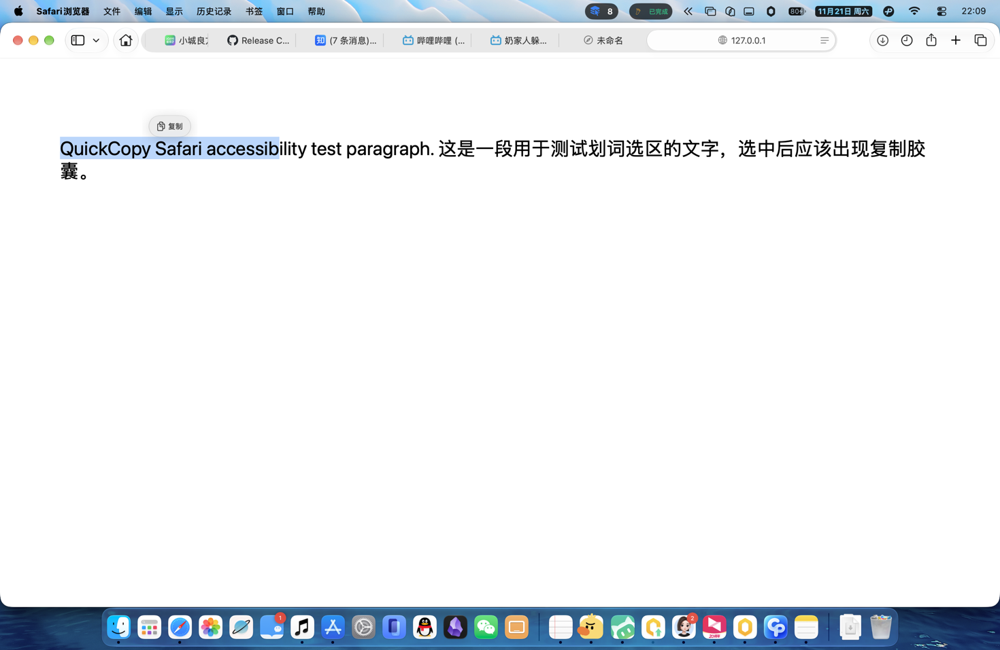
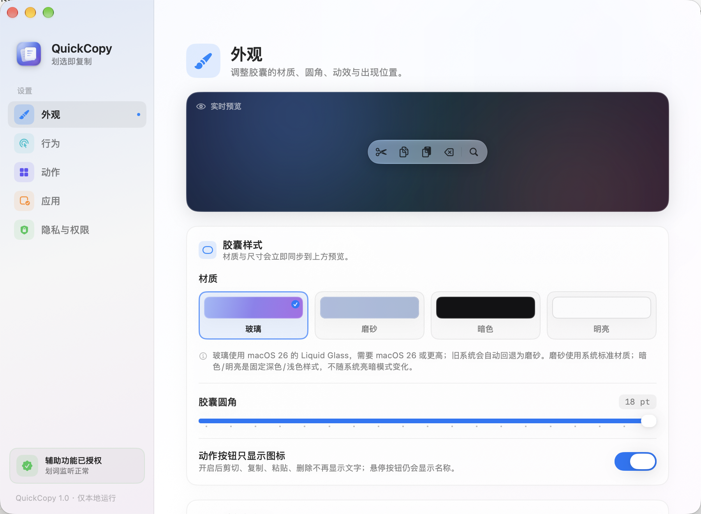
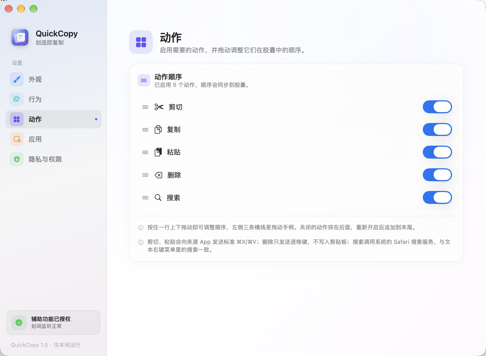

# QuickCopy

一款轻量的 macOS 划词工具：选中文字后，在选区上方立即弹出原生胶囊，提供剪切、复制、粘贴、删除、打开链接和系统搜索。外观、动作顺序与触发范围均可自定义。



## 下载与首次打开

前往本仓库的 [Releases 页面](https://github.com/Alex-Mahone/QuickCopy/releases) 下载最新版 `QuickCopy.app.zip`，解压后将 `QuickCopy.app` 移到「应用程序」文件夹，再从启动台或访达打开。

首次启动会请求**辅助功能权限**（用于读取选中文字和弹出胶囊）。请在弹出的提示中允许，或前往 **系统设置 → 隐私与安全性 → 辅助功能**，勾选 QuickCopy。授权后无需重启应用。

> 当前版本使用本机自签证书，未经 Apple 公证。若 macOS 提示「无法打开，因为来自身份不明的开发者」，右键点击 App 选择「打开」，在弹窗中再次点击「打开」即可。

## 功能

- **划词即现**：松开鼠标后瞬时弹出胶囊，定位在整段选区上方；多行选区也不会遮挡选中文字，空间不足时自动翻到下方。
- **内置动作**：剪切、复制、粘贴、删除、打开链接、系统搜索。「打开链接」仅在整段选区本身是网址时出现；剪切/粘贴/删除只在可编辑文本中出现。
- **动作可排序、可开关**：在设置中拖动动作卡片调整按钮顺序，按需关闭不需要的动作；可选择只显示图标。
- **外观可调**：玻璃（macOS 26+ 原生液态玻璃）、磨砂、暗色、明亮四种材质；胶囊大小、圆角、弹出偏移均可调整，设置页实时预览。
- **触发范围可控**：按 bundle id 排除特定应用，或按域名（含子域名）排除网站；密码框等安全输入控件自动跳过。
- **菜单栏管理**：无 Dock 图标，通过菜单栏开关启用状态、打开设置、检查权限或退出。





## 系统要求与权限

| 项目 | 要求 |
| --- | --- |
| 系统 | macOS 13 或更新版本 |
| 芯片 | 当前安装包为 Apple 芯片版（arm64）；Intel Mac 可参照下方从源码构建 |
| 辅助功能权限 | 必需。用于读取选中文字、定位选区、监听鼠标抬起与 ESC；不记录键盘输入 |
| 网络 | 应用本身不联网 |

## 数据与隐私

QuickCopy 仅在本机运行，无账号、无云同步、无使用统计。不保存选中的文字：复制的内容只存在于系统剪贴板。配置（外观、动作顺序、排除列表等）保存在 `~/Library/Preferences` 的 UserDefaults 中。添加网站排除项时只保存主机名，不记录浏览历史。搜索调用 macOS 系统服务，使用系统默认搜索引擎。

## 从源码构建

需要 macOS 与 Command Line Tools（无需完整 Xcode）。

```bash
git clone https://github.com/Alex-Mahone/QuickCopy.git
cd QuickCopy
./build.sh
open build/QuickCopy.app
```

`build.sh` 会生成固定的本机自签证书（私钥保存在独立的钥匙串中），使辅助功能授权在重新编译后仍然有效。也可打开 `QuickCopy.xcodeproj` 用 Xcode 构建；若 Xcode 使用 ad-hoc 签名，需要重新授权一次辅助功能权限。

应用图标由代码绘制，可用 `swift tools/make_icon.swift` 重新生成。

## 开源许可与致谢

本项目基于 MIT 许可证开源，详见 [LICENSE](LICENSE)。全部代码使用 Apple 公开框架（AppKit、SwiftUI、ApplicationServices 等），未使用第三方库或私有 API。
